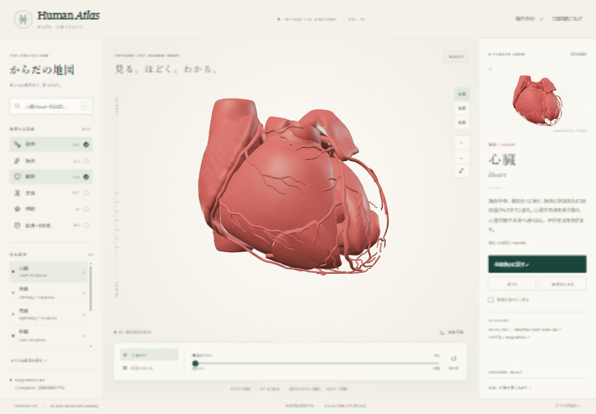

# Human Atlas

実際の人体モデルを使った日本語の教育用3D図鑑です。



BodyParts3Dの2,234メッシュを収録し、部位の検索、単独表示、分解表示に対応しています。人体データとライブラリを同梱しているため、ダウンロード後はローカルで探索できます。

## ダウンロード

GitHubの「Code → Download ZIP」でダウンロードして展開するか、以下のコマンドで取得します。

```sh
git clone https://github.com/tamir-ichikawa/human-atlas.git
cd human-atlas
npm start
```

リポジトリには約114MBのモデル・アプリデータを含みます。Node.jsが必要です。npmパッケージのインストールは不要です。

## 起動

1. このフォルダーの `start.cmd` をダブルクリックします。
2. ブラウザで `http://127.0.0.1:4318/` が開きます。
3. 読み込みが完了すると、人体を操作できます。

Node.js 18以上が必要です。制作したPCではNode.js 22で確認しています。追加のnpmインストール、APIキー、アカウントは不要です。`index.html` の直接ダブルクリックではなく、必ずローカルサーバーから開いてください。

Node.jsのある環境では `npm start` または `node server.mjs` でも起動できます。ポートを変える場合は環境変数 `HUMAN_ATLAS_PORT` を指定してください。サーバーは自分のPC（127.0.0.1）だけに接続を許可します。終了はサーバーのウィンドウでCtrl+Cです。

## 操作

- **回転**：モデルをドラッグ。3Dエリアにキーボードフォーカスを移して矢印キーでも操作できます。
- **拡大縮小**：ホイール、ピンチ、または＋／−ボタン。
- **平行移動**：右ドラッグ、または2本指。
- **検索**：英語名、部品ID、FMA ID。主要臓器は日本語でも検索できます。
- **選択**：モデル、検索結果、主要部位の一覧をクリック。
- **単独表示**：「この部位だけを見る」。もう一度押すと全体へ戻ります。
- **分解・復元**：「構造をひらく」スライダー。0%で組み立て位置に戻ります。
- **部品一覧**：「部品を並べる」で48部品ずつ表示。矢印で次のページへ進めます。検索や系統フィルターが適用されます。
- **リセット**：表示系統、非表示部品、分解、検索、視点を初期状態へ戻します。

## 収録データと表示上の区別

BodyParts3D 4.0 の `isa_BP3D_4.0_obj_99.zip` に含まれる **2,234個のメッシュをすべて収録**しています。2,234個の臓器という意味ではありません。元の形状と部品間の組み立て位置を保持し、座標軸の回転と単位変換、表示用バイナリへの変換を行っています。

元データの17部品には名称・概念IDが記載されていないため、「名称未記載（原典）」とFJ番号を表示します。残りの部品は原典の英語名・概念IDを保持します。すべての個別部品名を日本語に翻訳したものではありません。

心臓・左右の肺・肝臓・胃・腎臓・脳は、原典のPART-OF/IS-A対応表から構成部品をまとめて選択できます。部品の色と6つの表示分類は探索のための補助です。主要部位の選択にはその部位に属する細かな血管なども含まれます。生体の実際の色や医学的な分類を完全に再現するものではありません。

分解表示は構造を観察するための模式的な移動です。「部品を並べる」では見やすい大きさに各部品を拡大縮小するため、大きさの比較には使えません。初期表示では骨格と臓器を表示し、筋肉・血管・神経・体表はフィルターで追加できます。

解説はNIH各機関の資料に基づく教育用の概要です。個別部品の解説に臓器・系統全体の概要を表示する場合、その旨を明示します。診断・治療のためのツールではありません。

## オフラインと動作環境

Three.jsとモデル、解説はすべてローカルに同梱しています。通常の探索で外部CDNやAPIに接続しません。出典の外部リンクを開くときだけインターネットが必要です。

WebGL 2・ES Modules・DecompressionStream対応の現行ブラウザを想定しています。全データを読み込むため、初回は数秒以上かかることがあります。全系統を表示すると約668万三角形となり、GPUや端末によって操作速度が変わります。重い場合は必要な系統だけ表示してください。

## ファイル

- `dist/index.html`, `dist/style.css`, `dist/app.js`：画面と3Dアプリ
- `dist/assets/atlas.json`：全メッシュの出典・名前・座標・配置情報
- `dist/assets/*.bin.gz`：系統別の形状・法線・インデックス
- `dist/assets/content.json`：日本語解説と資料URL
- `dist/vendor/`：Three.js 0.180.0、OrbitControls、MITライセンス
- `server.mjs`, `start.cmd`：ローカル起動
- `scripts/prepare_assets.py`：元のOBJからの変換スクリプト（numpyが必要）
- `THIRD_PARTY_NOTICES.md`：利用条件と変更内容

## 元データから再生成する場合

以下の公式ページにあるファイルを同じフォルダーへダウンロードします。

https://dbarchive.biosciencedbc.jp/en/bodyparts3d/download.html

- isa_BP3D_4.0_obj_99.zip
- isa_parts_list_e.txt
- isa_inclusion_relation_list.txt
- isa_element_parts.txt
- partof_parts_list_e.txt
- partof_element_parts.txt

`python scripts/prepare_assets.py <ダウンロードしたフォルダー>` で変換できます。配布元ZIPのSHA-256は `atlas.json` に記録しています。
